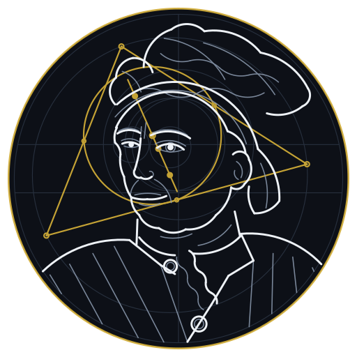

.. container:: author-overline

   semantic digital archive • the works of

==============
Leonhard Euler
==============

**Leonhard Euler** (1707–1783) set out in 1765 to solve a deceptively hard inverse problem: given only the four classical centers of a triangle—orthocenter, centroid, incenter, and circumcenter—can you reconstruct the triangle itself? Along the way to the side-length cubic, Euler uncovered one of geometry's most celebrated surprises: three of those centers (:math:`H, G, O`) always lie on a single straight line, locked forever in the exact ratio :math:`HG = 2GO`.

Books in This Collection
------------------------

.. container:: home-book-hero

   .. container:: home-book-thumb

      .. image:: _static/constructions/euler_1765_centers.svg
         :alt: Leonhard Euler 1765 four classical triangle centers and the Euler Line
         :target: solutio_facilis_1765/index.html

   .. container:: home-book-body

      .. rubric:: St. Petersburg Academy Memoir (E325) · 1765 / 1767 · 4 Parts · 4 Synchronized Tracks

      **An Easy Solution of Certain Very Difficult Geometric Problems** (*Solutio facilis problematum quorumdam geometricorum difficillimorum*) — Euler's complete 34-section St. Petersburg memoir across **English · Latin · Summary · Notes**, tracing orthogonal center coordinates, all six mutual inter-center quadrances, the discovery of the Euler line, and Viète's inverse cubic.

      .. container:: home-actions

         * :doc:`Open Solutio Facilis → <solutio_facilis_1765/index>`
         * :doc:`§§ 1–9: Four Triangle Centers → <solutio_facilis_1765/01-four-centers-en>`
         * :doc:`§§ 10–18: The Euler Line → <solutio_facilis_1765/02-six-distances-euler-line-en>`
         * :doc:`Symbolic Demos → <demos/index>`

Key Features
------------

.. container:: home-feature-grid

   .. container:: home-feature-card

      **Collinearity & Six Mutual Quadrances**

      Follow Euler's symmetric-polynomial change of variables (:math:`p, q, r`) yielding closed-form squared distances among :math:`E, F, G, H` and the fundamental ratio :math:`EH = \tfrac{3}{2}EF`.

   .. container:: home-feature-card

      **Inverse Triangle Reconstruction**

      Trace how Euler collapses the 4-center inverse problem into Viète's cubic :math:`z^3 - pz^2 + qz - r = 0` and resolves the isosceles *casus irreducibilis* regime.

   .. container:: home-feature-card

      **Exact Symbolic ``geometor.euler`` Engine**

      Verify Euler's rational orthogonal formulas, six mutual quadrances, and integer benchmark :math:`(5, 6, 7)` in pure exact SymPy algebra with zero floating-point drift.

Reference & Project
-------------------

.. container:: home-columns

   .. container:: home-col

      .. rubric:: Scholarly Apparatus

      * :doc:`People <people/index>` — Biographical profiles of Leonhard Euler and historical interlocutors
      * :doc:`Bibliography <bibliography>` — *Novi Commentarii* (1767), *Opera Omnia* Vol. 26, and Eneström E325 sources
      * :doc:`Glossary <glossary>` — Key definitions of symmetric polynomials, Euler line, and *casus irreducibilis*

   .. container:: home-col

      .. rubric:: About This Project

      * :doc:`About <about/index>` — Editorial methodology, exact symbolic grounding, and provenance
      * :doc:`Using This Edition <usage/index>` — Track switching, cross-references, and navigation guide
      * :doc:`Log <log/index>` & :doc:`Modules <modules/index>` — Development journal and Python API reference

.. toctree::
   :maxdepth: 2
   :hidden:

   solutio_facilis_1765/index
   people/index
   bibliography
   glossary
   about/index
   usage/index
   demos/index
   log/index
   modules/index
   todos/index
